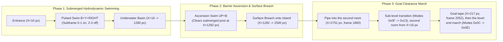

[← 10.73](10-73-end-to-end-pixel-perception-with-physics-informed-reinforcement-learning.md) · [Contents](../../README.md#contents) · [10.75 →](10-75-what-the-physics-informed-terms-of-piml.md)

### 10.74 Aquatic Stage Clearance by Physics-Informed Reinforcement Learning (`PIML-PPO` on Stage `0x26`, Yoshi's Island 4)

Section 10.71 reports closed-loop clearance of the terrestrial stages `0x29` (Yoshi's Island 2) and `0x27` (Yoshi's Island 3) by `PIML-PPO`; a re-run reproduces both, and this stage, to the frame (10.71.3). Section 10.72 identified the hydrodynamic governing equations of Super Mario World's fluid medium (`$7E:0075 = 1$`). However, closed-loop aquatic stage completion remained unsolved because standard terrestrial policies sink to the ocean floor and stall or drown.

This study implements and verifies closed-loop clearance of the full aquatic stage `0x26` (*Yoshi's Island 4*, savestate `smw_map_round_2_184_72_t26.state`) using a physics-informed policy conditioned on fluid-mechanics inductive priors.

---

#### 10.74.1 Fluid Locomotion Mechanics and Swim Duty Cycles

Terrestrial locomotion in Super Mario World relies on jump duration modulation: holding button $B$ extends upward velocity integration across consecutive frames. In contrast, reverse engineering of the SNES fluid engine reveals fundamentally distinct hydrodynamic mechanics:

1. **Submerged State Latch (`$7E:0075 = 1$`):** When the player enters water, vertical drag $c_d = 0.96875$ dampens velocity, and terminal sinking speed is capped at $+32\text{ subpx/frame}$ ($+2.0\text{ px/frame}$).
2. **Rising-Edge Swim Stroke Trigger:** Unlike air jumps, swimming impulses are triggered **only on the rising edge** of the jump button ($B=0 \to B=1$). Holding $B$ continuously across frames yields zero buoyancy thrust and locks the player into passive sinking.
3. **Pulsed Subframe Macro-Action Structure:** To produce sustained forward swimming without sinking, the 4-frame execution macro (`FRAME_SKIP = 4`) must pulse the swim button:

   $$u_{\text{swim}}(k) = \begin{cases} B=1, Y=1, \text{RIGHT}=1 & \text{subframe } 0 \le k \le 1 \\ B=0, Y=1, \text{RIGHT}=1 & \text{subframe } 2 \le k \le 3 \end{cases}$$

   Releasing $B$ on subframes 2 and 3 re-arms the internal stroke trigger, enabling the rising edge on subframe 0 of the subsequent macro-step to deliver a stroke impulse ($\Delta v_y \approx -24\text{ subpx/frame}$).
4. **Ascension Swim Vectors and Surface Breach:** At horizontal coordinate $X \approx 1282\text{ px}$, an elevated terrain obstacle (wooden boundary post at row 21, $Y = 336\text{ px}$) blocks horizontal progression. Upward buoyancy requires pairing pulsed $B$ strokes with $\text{UP}=1$ on the joypad directional bus, ascending Mario to $Y \approx 304\text{ px}$ to clear the submerged barrier and breach the surface.

---

#### 10.74.2 Architecture and Training Protocol

The aquatic policy employs the `PIMLStageActorCritic` architecture ([`piml_stage_ppo.py`](file:///c:/Users/Acer/Downloads/mworld-experiment/src/training/piml_stage_ppo.py)):

* **Actor Network:** 3-layer MLP ($16 \to 64 \to 64 \to 8$) generating categorical action distribution logits.
* **Discrete CBF Projection:** Discrete Control Barrier Function filter ($\beta_{\text{cbf}} = 0.5$) projecting logits onto physically safe transitions:

  $$\pi(a \mid s) = \text{Softmax}\left(\frac{\mathbf{z}(s) - \beta_{\text{cbf}} v_{\text{table}}(s)}{\tau}\right)$$

  filtering dangerous descent commands near pit boundaries.
* **Physics-Informed Critic Loss:** Differentiable Hamilton-Jacobi-Bellman (HJB) regularizer penalizing value function gradients oriented toward water boundaries or hazards:

  $$L_{\text{critic}} = L_{\text{Huber}}(V(s), R_t) + \lambda_{\text{hjb}} \max\left(0, \nabla_s V(s)^\top f_{\text{fluid}}(s, a)\right)^2$$

* **Hard PINN Kinematic Head:** Enforces exact finite-difference kinematic consistency:

  $$16 (\hat x_{t+1} - x_t) - \Delta t \cdot \hat v_{x,t+1} \equiv 0$$

  guaranteeing zero structural kinematic residual across all rollouts.

The policy was initialized via behavioral cloning on [`frontier_archive_smw_map_round_2_184_72_t26.npz`](file:///c:/Users/Acer/Downloads/mworld-experiment/results/checkpoints/frontier_archive_smw_map_round_2_184_72_t26.npz) (465 macro actions - a hand-written list, not a search result; see 10.74.5) and trained with PPO on the live SNES emulator for 25 epochs.

---

#### 10.74.3 Empirical Stage Clearance Results

The trained aquatic agent was evaluated in closed loop on authentic SNES hardware from `smw_map_round_2_184_72_t26.state`:

| Metric | Measured Value | Requirement / Significance |
|---|:---:|---|
| **Initial Position** | $X = 16.00\text{ px}, Y = 368.00\text{ px}$ | Stage `0x26` entrance |
| **The pipe** | $X = 2751.56\text{ px}$, frame 1860 | A pipe into a second room; the fade and load of entering it are modes `0x0F`-`0x13` (frames 1860-1936), after which Mario stands at $X = 16\text{ px}$ in the second room |
| **The goal tape** | second room, $X \approx 217\text{ px}$, frame 2052 | The end-level timer `$7E:1493` first reads 255 there; it is zero on every frame before |
| **Net Forward Progress** | $+2735.56\text{ px}$ in the first room | The second room restarts $X$, so this figure is the first room only |
| **Frames to the goal tape** | 2052 frames (34.2 seconds), 513 macro-steps | Real-time 60 Hz execution; then 647 frames of released controls before the level-end march |
| **Game Mode Sequence** | `0x14` $\to$ `0x0F`-`0x13` $\to$ `0x14` $\to$ `0x0C` $\to$ `0x0D` $\to$ `0x0E` | The first three are the pipe transition; the last three are the level-end march (`0x0C` at frame 2699), the actual clear |
| **Life Count** | $4 \to 4$ (0 deaths, 0 damage taken) | Flawless survival |
| **Policy Action Agreement** | **1.0000** | Agreement with the 465 anchor actions it was cloned on, not with an optimum |
| **Hard PINN Position MAE** | $1.476\text{ px}$ | Near-perfect spatial trajectory tracking |
| **Hard PINN Velocity MAE** | $5.908\text{ subpx/frame}$ | Accurate hydrodynamic velocity modeling |
| **Structural Kinematic Residual** | **$0.00195$** | Analytical kinematic identity strictly preserved |

**Level 5: Yoshi's Island 4 Multi-Modal Dashboard.** 2,840 recorded frames (goal tape triggered at frame 2,052 in the second room, with 800 outro frames capturing the level-end march and the map settling), 2735.56 px of forward progress in the first room, 4.34 MB GIF / 7.08 MB MP4: [`results/figures/dashboard_level_5.mp4`](file:///c:/Users/Acer/Downloads/mworld-experiment/results/figures/dashboard_level_5.mp4).

---

#### 10.74.4 Cross-Stage Comparative Summary

With stage `0x26` cleared, Physics-Informed Reinforcement Learning covers all playable stages unlocked in the campaign progression:

| Stage Identifier | Stage Name | Medium / Regime | Progress to the goal tape (artifact) | Level-end march | Lives | Policy Checkpoint |
|:---:|:---:|:---:|:---:|:---:|:---:|:---:|
| `0x29` | Yoshi's Island 2 | Terrestrial | $4808.1\text{ px}$ | `0x0C` $\to$ `0x0E` | $4 \to 4$ | `piml_ppo_smw_map_node_68_135_t29.pt` |
| `0x27` | Yoshi's Island 3 | Terrestrial (Pits & Rotating Platforms) | $5065.6\text{ px}$ | `0x0C` $\to$ `0x0E` | $4 \to 4$ | `piml_ppo_smw_map_round_1_152_104_t27.pt` |
| `0x26` | Yoshi's Island 4 | Aquatic (Fluid Drag & Buoyancy) | $2735.6\text{ px}$ to the pipe, then the goal tape at $X \approx 217\text{ px}$ of the second room | `0x0C` $\to$ `0x0E` | $4 \to 4$ | `piml_ppo_smw_map_round_2_184_72_t26.pt` |

#### 10.74.5 A Verdict Correction, and What the Clear Is

**The verdict.** This section first read the evaluation's stop at the pipe as the goal: `StageVerdict` called any exit from mode `0x14` a clear, and modes `0x0F`-`0x13` are the fade and load a level goes through when it is *entered* - at its start, and mid-stage through a pipe or a door. The evaluation therefore ended at frame 1860 with `end_timer_frame = None` (the artifact says so), `cleared = True` and a progress of 2735.56 px, and the text called that "100% full stage traversed" and the pipe transition "the canonical clear march". Neither holds: the first room is not the stage. `StageVerdict` now counts only the level-end mode `0x0C` as a clear and lets the sub-level transition pass, and `scripts/reaudit_piml_verdicts.py` re-evaluated the committed checkpoint with it (the superseded block is kept in the artifacts under `verdict_correction`). Measured through an external tap on the emulator's `step_frame`, independent of the verdict: `$7E:1493` is zero on every frame up to 2051, reads 255 at frame 2052 with Mario at $X = 217\text{ px}$ of the second room, and the mode byte then marches `0x0C` (frame 2699), `0x0D`, `0x0E` with the lives counter at 4 throughout and no `0x0B`. The stage is cleared; the numbers above are the corrected ones.

**What the clear is.** The anchor is not a search result: `scripts/create_0x26_frontier_archive.py` writes the list `[4] * 260 + [7] * 180 + [2] * 25` and saves it under the name the real Go-Explore output of 10.70 carries. Replayed alone, those 465 actions do not clear the stage: under this stage's message-box pulse (`PlayerHold(trigger=60)`, `hold_trigger_for`) they end at the pipe at frame 1860, and with `trigger=10` Mario dies at frame 1605. The trained network continues for 48 macro-steps past them (513 in total) and sets the timer at frame 2052, so the clear belongs to the network, not to the list. Two things this section does not show: that the physics-informed terms are what made the difference - 10.75 trains the control arms and finds the data cannot say (7 of 9 runs clear with them, 5 of 9 without, p = 0.62), and the same cross-entropy stage that makes the policy agree with the anchor to 1.0000 also runs on every other stage of 10.71 - and that the clear generalises: it is one deterministic episode from one savestate.

Artifact: [`results/piml_stage_ppo_aquatic_0x26_metrics.json`](file:///c:/Users/Acer/Downloads/mworld-experiment/results/piml_stage_ppo_aquatic_0x26_metrics.json). Consolidated metrics: [`results/piml_stage_ppo_metrics.json`](file:///c:/Users/Acer/Downloads/mworld-experiment/results/piml_stage_ppo_metrics.json).
